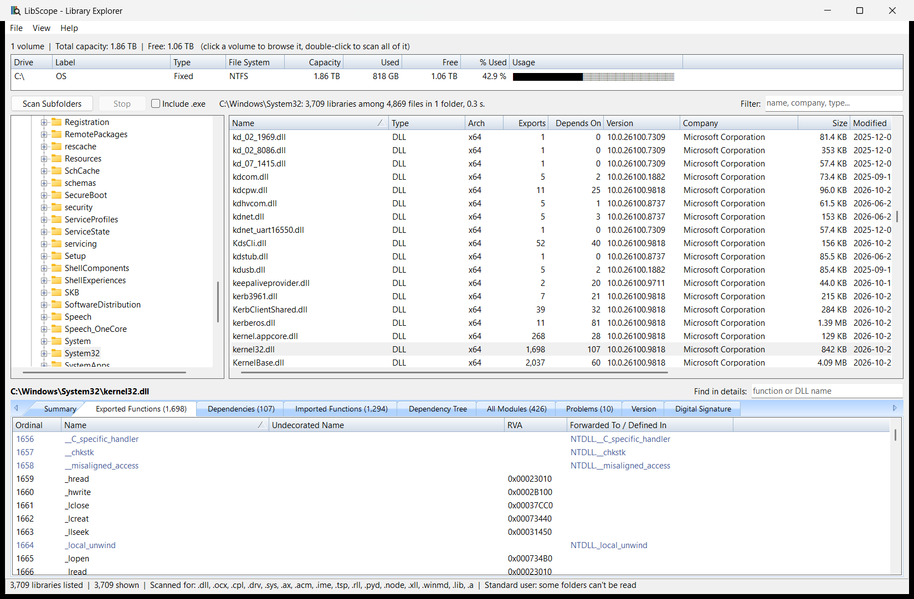
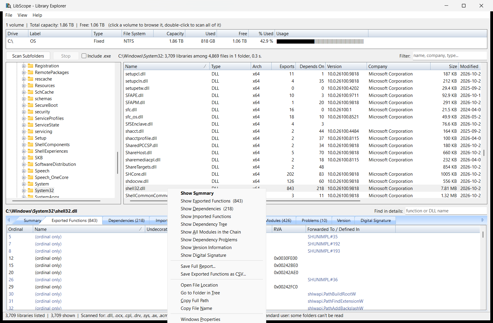
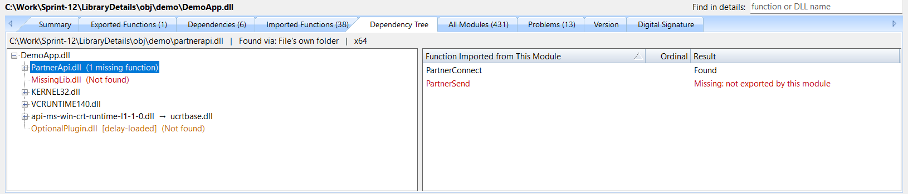
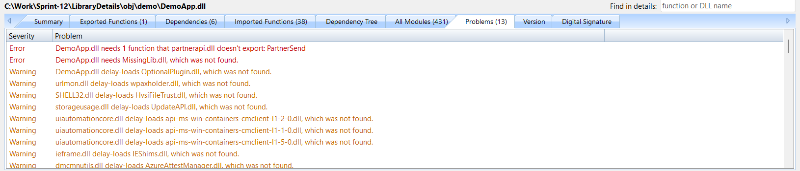
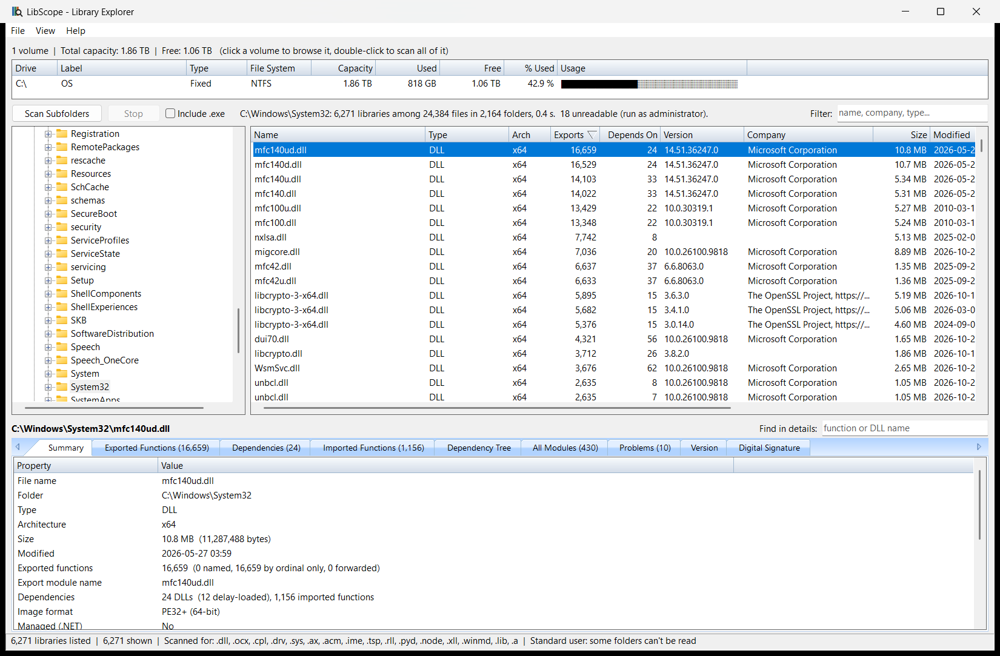
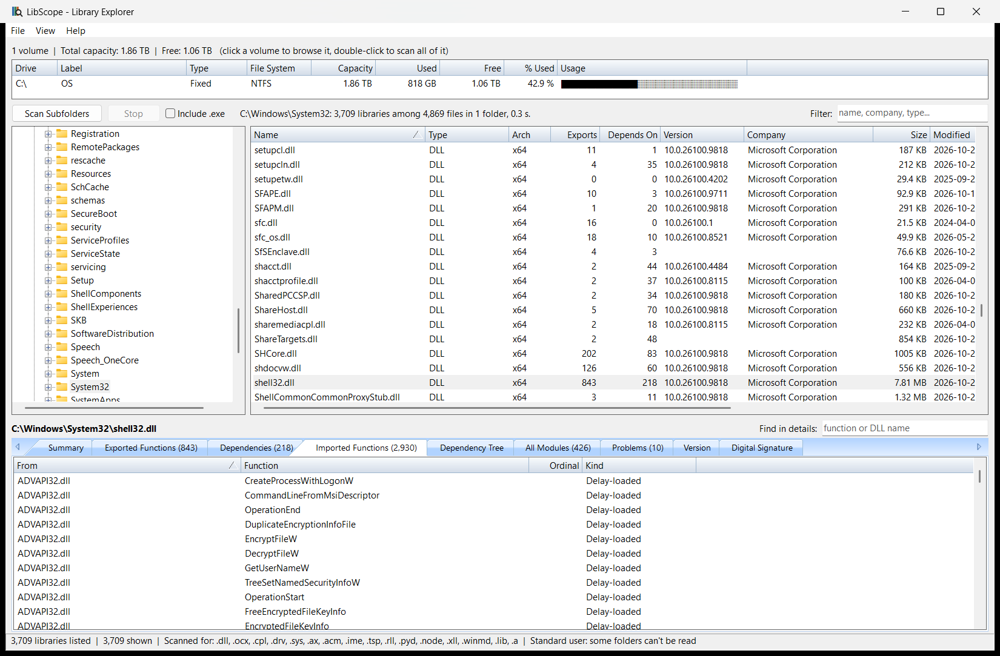
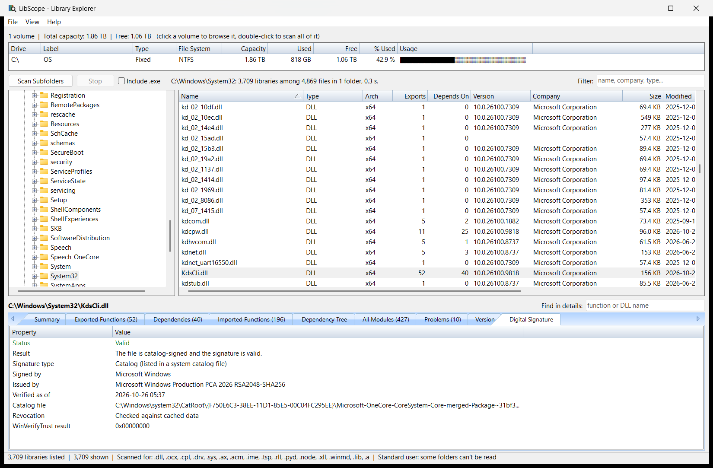
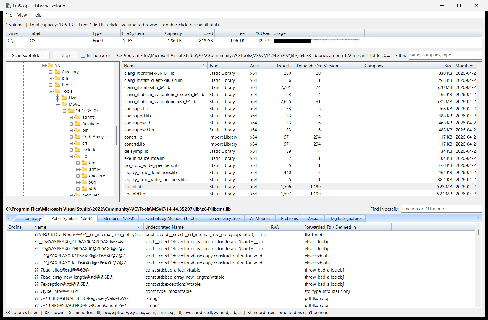

# LibScope – Windows Library Explorer (C++ / MFC)

Browses disk volumes and folders for DLLs and other libraries, and shows what each one exports,
what it depends on, its version information, and whether its digital signature is valid.
Like Dependency Walker, it follows the whole dependency chain and flags what would stop a file from loading.

Files are only ever read as data: nothing in them is loaded or run, so no `DllMain` executes, and
a 64-bit LibScope reads 32-bit libraries (and the reverse).

## Screenshots

**Exported functions**: touching a library loads its details below the list. Forwarded exports are shown in blue, with where they forward to.



**Right-click menu**: opens any details tab for that library, saves a report or CSV, or locates the file.



**Dependency tree**: the full chain, with each API set shown next to the DLL that implements it. On the right, the functions the parent needs from the selected module. This test DLL has deliberate faults: errors are in red, and optional dependencies that are missing are in orange.



**Dependency problems**: everything found in the chain, most severe first. Right-click a row to jump to it in the tree.



**Scanning subfolders**: a background search of the whole subtree, here sorted by number of exports.



**Imported functions**: each function a library imports and the DLL it comes from, including delay-loaded ones.



**Digital signature**: embedded and catalog signatures, with the signer and the catalog file.



**Static and import libraries**: `.lib` files show their public symbols and the object file that defines each one.



## Using it

- **Volumes**, at the top, is the same view as WinMon's Disk Volumes tab, plus removable drives. Click a volume to browse it; double-click to scan all of it.
- **Folder tree**: selecting a folder lists the libraries directly inside it. **Scan Subfolders** (or the right-click menu) searches the whole subtree in the background; **Stop** keeps what was found so far.
- **Library list**: touching a row loads its details below. Click a column header to sort. **Filter** narrows the list by any column. Greyed rows could not be analysed, and the reason is in the Company column.
- **Details tabs**: Summary, Exported Functions, Dependencies, Imported Functions, Dependency Tree, All Modules, Problems, Version, Digital Signature. **Find in details** narrows the function, dependency, module and problem lists, and it stays set as you move between libraries, so you can look for one function across several DLLs. Drag the gaps between the panes to resize them.

### Dependency checking

For each PE file, LibScope works out the whole chain in the background: imports, delay-loaded imports, and forwarded exports.

- **Dependency Tree**: expand any module to follow the chain. A branch that leads back to a module above it ends there, marked `(circular)`. Selecting a module shows its path, how it was found, and each function its parent needs from it.
- **All Modules**: every module in the chain once, with its status, how it was found, architecture, version and path.
- **Problems**: DLLs that aren't found or can't be read, functions a DLL doesn't export, and modules of the wrong architecture. The Summary tab shows the totals.

| Severity | Meaning |
|---|---|
| Error | The file can't load: the fault is in a part of the chain that Windows must resolve at startup |
| Warning | It only matters if that code runs, such as a missing delay-loaded DLL. An API set with no implementation in the startup chain is also a warning, because these are optional by design |
| Info | An API set with no implementation, outside the startup chain |

Warnings are normal, and most come from Windows' own optional DLLs. On this Windows build a healthy DLL such as `kernel32.dll` shows 10. An error in a file that demonstrably works usually means something below applies.

DLLs are looked for in the order Windows uses: API sets, Known DLLs, the file's own folder, the system folder, the 16-bit system folder, the Windows folder, then `PATH`. Kernel-mode files also search `System32\drivers`. Moving between libraries stays quick, because parsed files are cached and a chain in progress stops as soon as the selection moves on.

### Right-click menus

| On | Commands |
|---|---|
| A library | Show Summary, Exported Functions, Dependencies, Imported Functions, Dependency Tree, All Modules, Dependency Problems, Version Information or Digital Signature; Save Full Report; Save Exported Functions as CSV; Open File Location; Go to Folder in Tree; Copy Full Path; Copy File Name; Windows Properties |
| A folder | List Libraries in This Folder; Scan This Folder and Subfolders; Open in Explorer; Copy Path; Refresh Subfolders |
| A volume | Scan All of the drive; Browse in Folder Tree; Open in Explorer; Copy Path |
| A row in a details tab | Copy Selected Rows; Copy Name; Copy All Visible Rows; Select All; for a dependency, Show Its Functions; for a module, Analyse This Module; for a problem, Show in Dependency Tree |
| A module in the dependency tree | Analyse This Module; Open File Location; Copy Name; Copy Full Path |

Double-clicking a library opens its exported functions. `LibScope.exe <file or folder>` starts at that location.
**File → Save Library List as CSV** saves all the rows found.

### What counts as a library

`.dll .ocx .cpl .drv .sys .ax .acm .ime .tsp .rll .pyd .node .xll .winmd .lib .a`, plus `.exe` when **Include .exe** is ticked.

- PE files show their export table, including ordinal-only and forwarded exports, and their imports, including delay-loaded ones.
- `.lib` and `.a` archives have no export table. Their equivalent is shown instead: public symbols, and the object files (static library) or DLLs (import library) they belong to.
- A .NET assembly usually shows 0 exports, because its public types are in metadata; the Summary tab says so.

### Limits worth knowing

- The dependency check is static, and nothing is run, so it can differ from what happens in a real process:
  - **There's no runtime profiling.** DLLs a program opens itself with `LoadLibrary` don't appear.
  - **Side-by-side manifests aren't followed**, except that `comctl32.dll` is checked against the v6 copy in WinSxS, which nearly all programs use. A DLL supplied only through another manifest, such as an old Visual C++ runtime, shows as not found.
  - **The search assumes the file's own folder is the application's folder**, and it uses LibScope's own `PATH`. A DLL loaded by a program in another folder, or a program that changes its search path, can resolve differently.
  - **The current directory and `.local` redirection aren't considered.**
  - **Any-CPU .NET files are checked as this system's native bitness.** .NET assemblies loaded through the runtime don't appear in the chain.
- Reading protected folders needs elevation. LibScope runs as the current user, and reports how many folders it couldn't read. Run it as administrator for a complete scan.
- Junctions and symlinks are skipped, so nothing is listed twice through a link. Hard links, such as WinSxS ↔ System32, appear once per link.
- OneDrive online-only files are listed but not analysed, because reading them would download them.
- Revocation is checked against cached data only: signature checks never go out to the network. If nothing is cached, a valid signature says so on the Digital Signature tab.
- Network drives aren't listed as volumes, because a disconnected one would freeze the window. **File → Open Folder** reaches them.
- The 32-bit build sees `System32` through WOW64 redirection, so it shows `SysWOW64` there. Use the x64 build on 64-bit Windows.

## Build

Requires Visual Studio 2022 with *Desktop development with C++* and *C++ MFC for latest v143 build tools*.

```bash
"C:/Program Files/Microsoft Visual Studio/2022/Community/MSBuild/Current/Bin/MSBuild.exe" LibScope.sln -p:Configuration=Release -p:Platform=x64
```

Output: `bin\x64\Release\LibScope.exe`. MFC is linked statically, so it runs on its own.

## Tests

```bash
powershell -ExecutionPolicy Bypass -File Tests/CompareWithDumpbin.ps1
```

```bash
powershell -ExecutionPolicy Bypass -File Tests/SmokeTest.ps1 -Configuration Release
```

```bash
powershell -ExecutionPolicy Bypass -File Tests/CompareWithLoader.ps1
```

```bash
powershell -ExecutionPolicy Bypass -File Tests/DependencyFixtures.ps1
```

```bash
bin/x64/Release/ReaderTests.exe fuzz C:/Windows/System32/version.dll 200
```

```bash
bin/x64/Release/ReaderTests.exe sweep C:/Windows/System32
```

| Test | What it checks |
|---|---|
| `Tests\CompareWithDumpbin.ps1` | Exports, imports and library symbols match Microsoft's `dumpbin`, entry for entry, on 64-bit and 32-bit DLLs, a driver, and import and static libraries |
| `Tests\CompareWithLoader.ps1` | On running 64-bit and 32-bit processes, every DLL the chain calls required is really loaded from that path, and no errors are reported |
| `Tests\DependencyFixtures.ps1` | Builds test DLLs with a missing DLL, a missing function, the wrong architecture, an unreadable file, a missing delay-loaded DLL and a broken forward, and checks each is reported with the right severity |
| `ReaderTests fuzz` | Every reader, the dependency check and the API set parser survive corrupted and truncated copies of a file; any crash fails the run |
| `ReaderTests sweep` | Lists every error across a folder, which should be rare on a healthy system. About 5 to 15 minutes for `System32` |

## Continuous integration

`.github/workflows/build.yml` runs on every push or pull request to `main`, and can also be started by hand:

| Job | What it does |
|---|---|
| Build | Builds Debug and Release for x64 and x86 on `windows-2022`, then runs the smoke test and a short fuzz of the readers on each |
| Verify | Runs the `dumpbin` comparison, the loader comparison and the dependency fixtures |
| Release | On a push to `main` where all of that passes, publishes GitHub release `v1.0.<run number>` with `LibScope-v1.0.<run number>-x64.zip` and `LibScope-v1.0.<run number>-x86.zip` (exe + pdb) |

The same version is in the build artifacts' names and in `LibScope.exe`'s file properties, as `1.0.<run number>.0`. To change the major or minor number, edit `VERSION` at the top of the workflow. A local build is `1.0.0.0` unless you pass `-p:LibScopeVersion=1.2.3` to MSBuild.

## Setting up a private GitHub repository

These steps need [Git](https://git-scm.com/) and the [GitHub CLI](https://cli.github.com/). Run them from this folder. Sign in once:

```bash
gh auth login
```

Then create the local repository and the first commit:

```bash
git init -b main
```

```bash
git add .
```

```bash
git status
```

Check that list before committing: it should contain source files, scripts and `docs/screenshots`, with nothing from `bin/` or `obj/`.

```bash
git commit -m "Add LibScope library explorer"
```

Create the private repository and push to it (change the name if you prefer another):

```bash
gh repo create LibScope --private --source . --remote origin --push
```

The first push starts the pipeline. To follow it:

```bash
gh run watch
```

**Without the GitHub CLI**: create an empty **private** repository on github.com, with no README or `.gitignore`, then connect it, replacing `YOUR-ACCOUNT`:

```bash
git remote add origin https://github.com/YOUR-ACCOUNT/LibScope.git
```

```bash
git push -u origin main
```

**Good to know for a private repository**

- Only people you invite can see the code and releases. To add someone: **Settings → Collaborators**, or the command below.

```bash
gh api -X PUT repos/YOUR-ACCOUNT/LibScope/collaborators/THEIR-ACCOUNT
```

- Actions on a private repository use your account's monthly allowance, and Windows runners can use it up faster than Linux ones; GitHub's billing page has the current rates. Each push runs five Windows jobs, so to save minutes you can remove the `release` job, reduce the matrix, or remove the `push` trigger and start the pipeline by hand from the **Actions** tab.
- Every push to `main` publishes a release. Work on a branch and merge through a pull request if you don't want a release for each change:

```bash
git switch -c my-change
```

```bash
git push -u origin my-change
```

```bash
gh pr create --fill
```

- If Git reports `detected dubious ownership`, the folder belongs to another user, such as Administrators. Use the command it suggests, or take ownership of the folder.

## Status and pending work

**Done**: browsing and scanning; export, import, version and signature details; `.lib` and `.a` files; the dependency tree, API sets, and the missing DLL, missing function and wrong-architecture checks; reports; tests; the pipeline.

**Known results**: of the 3,709 libraries in `System32` on the development machine, 6 report errors, and each one names a file that really isn't on that machine:

| Files | Reported as not found | Likely reason |
|---|---|---|
| `uxlib.dll`, `spwizeng.dll` | `WDSUTIL.dll` | Probably belongs to a Windows component that isn't installed |
| `tssrvlic.dll` | `TlsBrand.dll` | Probably belongs to a Windows component that isn't installed |
| `DuCsps.dll` | `UpdateAPI.dll` | Probably belongs to a Windows component that isn't installed |
| `hvloader.dll`, `tcbloader.dll` | `winload.sys` | Boot-time files, which the boot environment resolves itself |

**Pending**

| Item | Notes |
|---|---|
| Manual checks | Windows Properties and Open File Location, the File menu's folder and library dialogs, a removable drive, and running as administrator |

**Possible later additions**, none of them started: following other side-by-side manifests, and runtime profiling, which would mean running the program being inspected, unlike the rest of LibScope.
| `Tests\SmokeTest.ps1` | The GUI starts on a real library, keeps running, and all threads shut down on close |

## Layout

| Part | Files |
|---|---|
| Bounds-checked file access, no MFC | `PeImage.*` |
| Export, import, version and signature readers | `DllExportReader.*`, `DllImportReader.h`, `FileVersionReader.h`, `FileSignatureVerifier.*` |
| `.lib` and `.a` archives | `LibArchiveReader.*` |
| Combines the readers for the UI | `LibraryAnalyzer.*` |
| Dependency chain, search order, API sets | `DependencyResolver.*` |
| Volumes (from WinMon `DiskMonitor`) | `VolumeEnumerator.*` |
| Multi-threaded scan (design from WinMon `FolderScanner`) | `LibraryScanner.*` |
| Selected library, loaded off the UI thread | `DetailLoader.*` |
| Owner-data sortable and filterable list | `VirtualList.*` |
| Lazily loaded folder tree | `FolderTree.*` |
| Details tabs | `DetailsPane.*`, `DependencyPanel.*` |
| Reports and CSV | `Report.*` |
| Main window | `LibScopeDlg.*`, `LibScope.*` |

## Changes to the supplied classes

The class names and public functions from `pe_analyzer_classes.zip` are unchanged, and new members were only added. The implementations had to change, because as supplied:

| Class | Problem | Now |
|---|---|---|
| `DllExportReader`, `DllImportReader` | `LOAD_LIBRARY_AS_DATAFILE` returns a tagged handle for a flat file mapping, but the code read it as a mapped image. `Load` failed on every DLL not already loaded in the process. | The file is mapped read-only, and RVAs are translated through the section table. |
| `DllExportReader`, `DllImportReader` | Native-sized headers meant a 64-bit build misread 32-bit DLLs, and the reverse. | The layout follows the file's own PE32 or PE32+ format. |
| `DllExportReader`, `DllImportReader` | Offsets from the file were trusted, so one corrupt file could crash a whole scan. | All file offsets are bounds-checked. |
| `DllExportReader` | The undocumented `__unDName` was used for demangling. | Documented `UnDecorateSymbolName`, which also handles names in import libraries. |
| `DllImportReader` | Delay-loaded dependencies were missed. | They are listed and marked as delay-loaded. |
| `FileSignatureVerifier` | It didn't compile against the Windows SDK (`WTD_REVOKE_WHOLE_CHAIN`, `pwszURLPollAuthorization`, `dwSettings`). It also checked only embedded signatures, so catalog-signed Windows files were reported as unsigned. | Corrected, with a catalog check (SHA-256, then SHA-1), the signer's name, and a separate result for "valid, revocation unknown". |
| `FileVersionReader` | Only the first declared translation was tried. | Common fallback tables are tried too, and the binary version numbers are added. |

`compatibility.manifest` is also required: without it, Windows reports files' binary versions as `6.2.x`.
